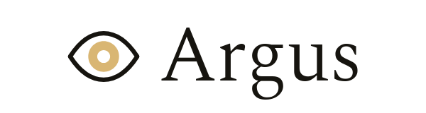
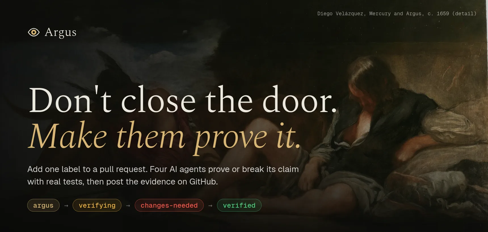
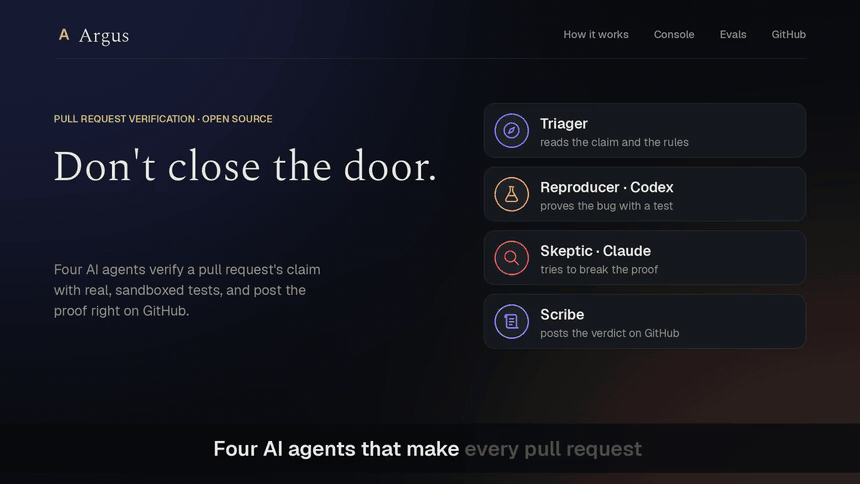
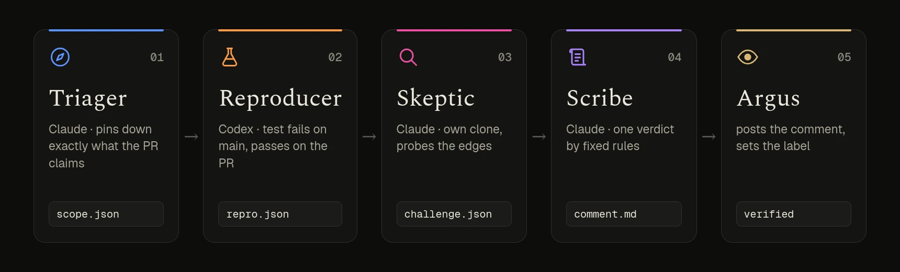
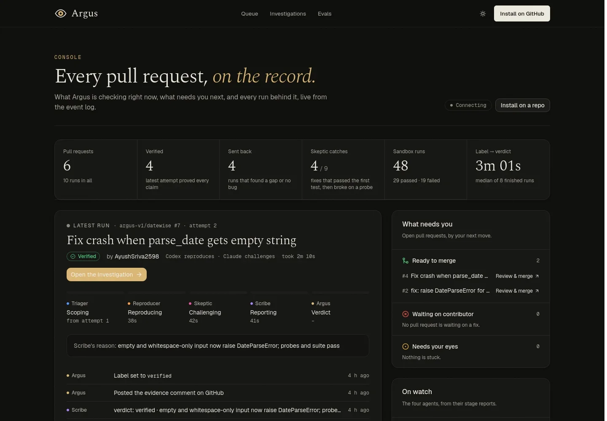
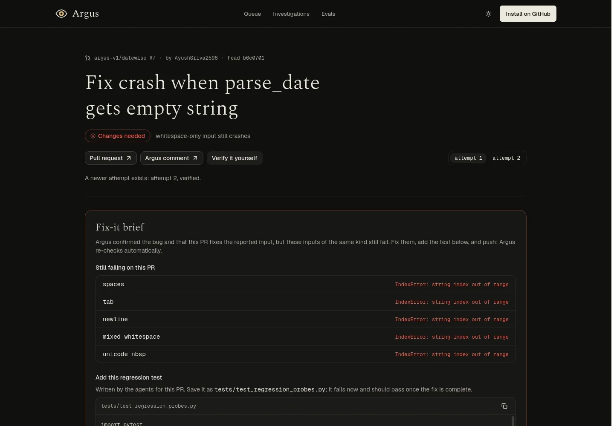
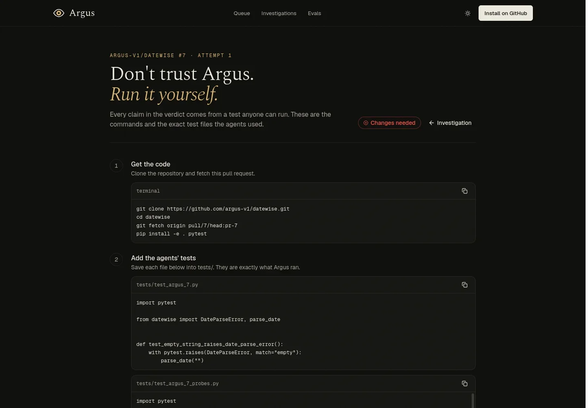
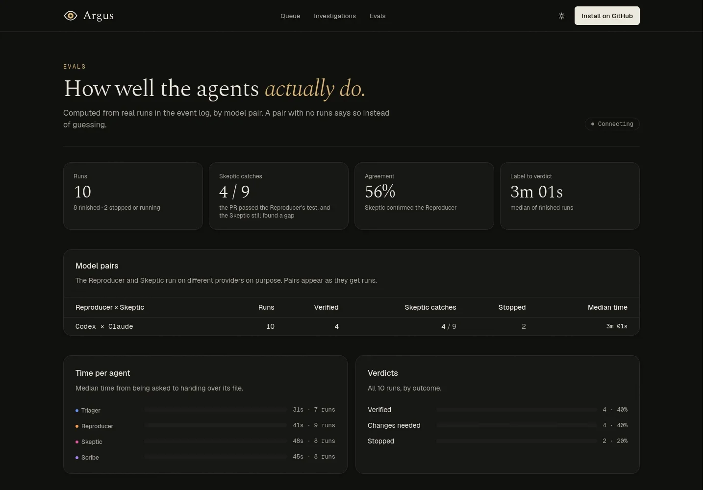

<div align="center">

<picture>
  <source media="(prefers-color-scheme: dark)" srcset="brand/argus-wordmark-dark.png">
  <source media="(prefers-color-scheme: light)" srcset="brand/argus-wordmark-light.png">
  
</picture>

**Don't close the door. Make them prove it.**<br>
Four AI agents verify a pull request's claim with real, sandboxed tests when a maintainer adds one label, then post the evidence on GitHub.

[](https://argus-alpha-sand.vercel.app)
[](https://argus-alpha-sand.vercel.app/console)
[](https://argus-alpha-sand.vercel.app/evals)
[](https://argus-alpha-sand.vercel.app/argus-demo.mp4)
[](https://github.com/sandbox-quantum/switch)
[](#how-it-works)
[](#how-it-works)

<a href="#watch-it-work">
  
</a>

</div>

Maintainers wake up to thirty pull requests. Most look professional, many were written by an AI in seconds, and some fix nothing. Checking each one still costs an hour, so projects either burn out or close the door to outside contributors. Argus is the third choice.

- 🏷️ **One label, no setup in the repo**. A maintainer adds `argus` to a pull request. That is the whole trigger. No config file, no CI changes, and a new push re-checks on its own.
- 🔬 **Proof, not opinions**. Argus doesn't review style. It proves the PR's claim: a test that fails on `main` and passes on the PR, run in a Docker sandbox with no network.
- 🔍 **A skeptic on a different model**. The Reproducer runs on Codex, the Skeptic on Claude, from its own clone. Its only job is to break the proof, and it often does: `''` is fixed, but `'   '` still crashes.
- 🧾 **One comment, every line with a receipt**. The verdict and its one reason first, a ✔/✘ table of claims with the command behind each, and the logs folded away. The label moves `verifying` → `changes-needed` → `verified`.
- 💬 **In the room your team already uses**. The agents talk in your Discord through [Switch](https://github.com/sandbox-quantum/switch), so you can watch, or step in, in plain words.
- 👁 **A public record anyone can re-run**. Every run lands live on the [website](https://argus-alpha-sand.vercel.app/console): timeline, sandbox results, the agent-written tests, and the exact commands to verify it yourself.

## Get started in three steps

1. **Install the Argus GitHub App** on a repository: [github.com/apps/argus-v1](https://github.com/apps/argus-v1/installations/new).
2. **Add the `argus` label** to any pull request.
3. **Read the comment.** About three minutes later Argus posts the evidence on the PR and sets its label. Watch it happen live on the [console](https://argus-alpha-sand.vercel.app/console). You merge with GitHub's own button, as always.

| Label | Colour | Meaning |
| --- | --- | --- |
| `argus` | brand | A maintainer opted this PR in |
| `verifying` | amber | The agents are working |
| `changes-needed` | red | The proof found a gap, or the bug didn't reproduce |
| `verified` | green | Every claim proven, suite green |

> [!NOTE]
> The hosted App currently runs for repositories in the `argus-v1` organization. To put Argus on your own repositories today, run your own copy in about half an hour: see [Run it yourself](#run-it-yourself).

## Watch it work

A contributor fixes `parse_date('')` in [argus-v1/datewise](https://github.com/argus-v1/datewise), with no test. The maintainer adds one label. The Reproducer proves the bug and the fix, the Skeptic finds that whitespace still crashes, the Scribe posts *changes needed*, the contributor pushes a better fix, and Argus re-checks on its own: *verified*.

<!-- For an inline player: open any PR or issue comment box on GitHub, drag in web/public/argus-demo.mp4,
     copy the github.com/user-attachments/assets/... URL it gives you (no need to post the comment), and
     put that URL on its own line below, replacing the preview link. -->

<div align="center">
  <a href="https://argus-alpha-sand.vercel.app/argus-demo.mp4">
    
  </a>
  <br>
  <sub>▶ <a href="https://argus-alpha-sand.vercel.app/argus-demo.mp4"><b>Watch the full film (2:46)</b></a> · screen recordings of a live run on <a href="https://github.com/argus-v1/datewise/pull/7">datewise #7</a>: GitHub, the Discord room and the console, narrated</sub>
</div>

<details open>
<summary><b>🧾 The comment Argus posted on <a href="https://github.com/argus-v1/datewise/pull/7">datewise #7</a></b></summary>

<br>

> ### 👁 Argus verification · PR #7
>
> **✘ Changes needed**: the fix handles `''`, but whitespace-only input such as `'   '` still crashes with `IndexError`.
>
> | Claim | Result | Proof |
> | --- | --- | --- |
> | Bug exists on `main` | ✔ | `test_argus_7.py` fails with `IndexError` at `parser.py:48` |
> | PR fixes the reported case `''` | ✔ | same test passes on `pr-7` |
> | Whitespace-only `'   '`, `'\t'`, `'\n'`, `' \t\n '` | ✘ | 4 probes fail with `IndexError` at `parser.py:51` |
> | Unicode spaces | ✘ | probe fails with `IndexError` at `parser.py:51` |
> | `None` still raises `TypeError` | ✔ | probe passes |
> | Existing test suite | ✔ | 19 passed, 0 failed |
>
> Add a test for `'   '` and run the empty check after `.strip()`, so whitespace-only input raises `DateParseError` too.
>
> **Who checked what:** Triager (Claude) · Reproducer (Codex) · Skeptic (Claude) · Scribe (Claude)
>
> [Investigation timeline](https://argus-alpha-sand.vercel.app/investigations/argus-v1/datewise/7/1) · [Verify it yourself](https://argus-alpha-sand.vercel.app/investigations/argus-v1/datewise/7/1/bundle)

</details>

<details>
<summary><b>💬 What the room looks like</b></summary>

<br>

Every agent posts one message per step in the same shape, so the room reads like a production tool. For example:

```
🔍 SKEPTIC · PR #7 · challenging
Passes for ''. Fails for '   ' (whitespace). Same IndexError. Fix is incomplete.
> pytest tests/test_argus_7_probes.py  ->  5 failed, 1 passed
model: Claude · 31s
STATUS: done
```

Argus posts the stage banners (`▶ Stage 3/5 · Challenging · PR #7`) and @mentions whoever's turn it is.

</details>

## How it works

<div align="center">
  
</div>

| | Agent | Runs on | Its one job | Hands over |
| --- | --- | --- | --- | --- |
| 🧭 | **Triager** | Claude Code | Reads the PR, the linked issue and `CONTRIBUTING.md`; writes down exactly what the PR claims to fix | `scope.json` |
| 🧪 | **Reproducer** | Codex | Writes a test that fails on `main` and passes on the PR | `repro.json`, `test_argus_N.py` |
| 🔍 | **Skeptic** | Claude Code | Re-runs the proof from its own clone, probes the neighbours of the reported input, runs the full suite | `challenge.json`, `test_argus_N_probes.py` |
| 📜 | **Scribe** | Claude Code | Turns the evidence into one comment and decides the verdict by fixed rules. One failed claim means not verified | `comment.md`, `verdict.json` |

**Argus**, the orchestrator, is the only participant that touches GitHub. It receives the App's webhooks, walks the stages `scoping → reproducing → challenging → reporting → verdict`, @mentions each agent in the room, waits for its file in `shared/evidence/pr-N/`, then posts the Scribe's comment as `argus-v1[bot]` and sets the label. Agents never get a GitHub token.

<details>
<summary><b>🔒 The sandbox</b></summary>

<br>

Contributor code never runs on the host. `sandbox/run_tests.py` exports the commit with `git archive` (no `.git`, no hooks), copies the agent's test in, and runs pytest in a container with **no network**, a read-only filesystem, CPU, memory and process limits, no capabilities and an unprivileged user. Each run writes `<label>.json` and `<label>.log` to the evidence folder, and every result reaches the event log.

</details>

<details>
<summary><b>🔁 Re-verify on push</b></summary>

<br>

A new commit on a labelled PR cancels any run in progress, archives the attempt to `pr-N/attempt-K/`, and starts attempt K+1 from *reproducing*. The website keeps every attempt, so the trail ✘ → ✔ stays on the record.

</details>

<details>
<summary><b>📈 One event log for everything</b></summary>

<br>

The orchestrator writes every step to Supabase (`investigations`, `events`; see [`supabase/migrations`](supabase/migrations)). The same log feeds the GitHub comment, the live website and the evals. The website reads it with the public, select-only key.

</details>

## The console

A public, read-only window on every investigation, live as the agents work. Light and dark themes, and every page links back to the pull request.

<table>
  <tr>
    <td width="50%"><a href="https://argus-alpha-sand.vercel.app/console"></a><br><sub><b>Console</b>: headline figures, the run in focus, what needs you, every PR's attempt trail, live activity</sub></td>
    <td width="50%"><a href="https://argus-alpha-sand.vercel.app/investigations/argus-v1/datewise/7/1"></a><br><sub><b>Investigation</b>: the verdict, a fix-it brief for the contributor, the timeline and every sandbox run</sub></td>
  </tr>
  <tr>
    <td width="50%"><a href="https://argus-alpha-sand.vercel.app/investigations/argus-v1/datewise/7/1/bundle"></a><br><sub><b>Verify it yourself</b>: the exact commits, the agent-written tests and the commands to re-run each check</sub></td>
    <td width="50%"><a href="https://argus-alpha-sand.vercel.app/evals"></a><br><sub><b>Evals</b>: Skeptic catches, agreement and time per agent, by model pair, from real runs only</sub></td>
  </tr>
</table>

## What Argus is not

- ❌ **Not a code reviewer**. It has no opinions on style, naming or design. It checks one thing: does the PR do what it says, and does it break anything.
- ❌ **Not a merge bot**. Approvals and merges stay with the maintainer and GitHub's normal buttons. Argus only comments and labels.
- ❌ **Not a gatekeeper against contributors**. The contributor gets the same evidence the maintainer sees, including the failing inputs and a test to add. A fair hearing, instead of a closed door.

## Run it yourself

Argus is a Python orchestrator (standard library only), four Switch agents, a Docker sandbox and a Next.js website. You need Python 3.11+, Docker, Node 20+, the [Switch Console](https://github.com/sandbox-quantum/switch#get-started-in-two-steps) app with Claude Code and Codex logged in, a Discord server, a Supabase project and an [ngrok](https://ngrok.com) static domain.

```sh
git clone https://github.com/argus-v1/argus.git && cd argus
cp .env.example .env        # every key the project reads; .env is git-ignored
```

<details>
<summary><b>1. Create your GitHub App</b></summary>

<br>

```sh
scripts/create_github_app.py --name "Argus"
```

Open the printed localhost address while signed in to your org, click **Create GitHub App**, and the script saves the private key to `.secrets/github-app.pem` and the App's IDs and webhook secret to `.env`, then sends you to install it. It asks for Contents (read), Issues and Pull requests (write), and the Pull request, Issue comment and Label events.

</details>

<details>
<summary><b>2. Create the event log</b></summary>

<br>

Put your Supabase URL, anon key, service key and database password in `.env`, then:

```sh
supabase link --project-ref <your-ref>
supabase db push
```

</details>

<details>
<summary><b>3. Build the sandbox and the agents' clones</b></summary>

<br>

```sh
docker build -t argus-sandbox:py3.12 sandbox/
scripts/setup_workspaces.sh   # read-only clones for the Triager, Reproducer and Skeptic
```

Set `GITHUB_ORG` and `DEMO_REPO` in `.env` to the repository you want verified.

</details>

<details>
<summary><b>4. Add the four agents in Switch Console</b></summary>

<br>

Connect Discord in Switch Console and map your review channel (we use `#pr-review`) to a room. Add four agents, each with its working directory, and add all four to the room:

| Agent | Provider | Working directory | Role file |
| --- | --- | --- | --- |
| `triager` | Claude Code | `agents/triager` | [`CLAUDE.md`](agents/triager/CLAUDE.md) |
| `reproducer` | Codex | `agents/reproducer` | [`AGENTS.md`](agents/reproducer/AGENTS.md) |
| `skeptic` | Claude Code | `agents/skeptic` | [`CLAUDE.md`](agents/skeptic/CLAUDE.md) |
| `scribe` | Claude Code | `agents/scribe` | [`CLAUDE.md`](agents/scribe/CLAUDE.md) |

In Discord, create a webhook for the channel and put its URL in `DISCORD_WEBHOOK_URL`: Argus posts banners and @mentions through it. In each agent's settings, let the Argus poster talk to the agent.

</details>

<details>
<summary><b>5. Start the orchestrator</b></summary>

<br>

```sh
scripts/run_orchestrator.sh   # orchestrator on :8787 behind https://$NGROK_DOMAIN/webhook
```

Point the GitHub App's webhook URL at `https://<your NGROK_DOMAIN>/webhook`. Optional settings: `ARGUS_SITE_URL` (fills the timeline and verify links in the comment), and `ARGUS_REPRODUCER_MODEL` / `ARGUS_SKEPTIC_MODEL` (the names shown in evals). Tests: `cd orchestrator && python3 -m unittest discover -s tests -t .`

</details>

<details>
<summary><b>6. Deploy the website</b></summary>

<br>

```sh
cd web && npm install
# web/.env.local: NEXT_PUBLIC_SUPABASE_URL, NEXT_PUBLIC_SUPABASE_ANON_KEY, NEXT_PUBLIC_GITHUB_APP_SLUG
npm run dev                   # http://localhost:3000
```

On Vercel, import the repository with **Root Directory** `web` and set the same three variables. Every push to `main` redeploys. Notes for working on the site are in [`web/CLAUDE.md`](web/CLAUDE.md).

</details>

<details>
<summary><b>🎬 Rehearse a demo</b></summary>

<br>

```sh
scripts/rehearse.sh open --label   # open the scripted partial-fix PR on the demo repo and label it
scripts/rehearse.sh fix <pr>       # push the follow-up fix: re-verification starts on its own
scripts/rehearse.sh reset <pr>     # clear labels, close the PR, clear its evidence
```

</details>

## Repository layout

```
argus/
├── agents/               one working directory per Switch agent, with its role file
│   ├── triager/          Claude Code · scopes the claim
│   ├── reproducer/       Codex       · fails on main, passes on the PR
│   ├── skeptic/          Claude Code · re-runs from its own clone, tries to break the proof
│   └── scribe/           Claude Code · writes the evidence comment
├── orchestrator/         Python: webhooks, state machine, room posting, GitHub writer, event log
├── sandbox/              Docker test runner: no network, CPU and time limits
├── bin/run_tests         the agents' front end to the sandbox
├── supabase/migrations/  event log schema (investigations, events)
├── web/                  Next.js website: landing, console, investigations, evals
├── scripts/              GitHub App setup, workspaces, orchestrator, rehearsals
├── brand/                wordmarks
└── shared/evidence/      hand-off files per PR (git-ignored)
```

The demo library lives in its own repository, [argus-v1/datewise](https://github.com/argus-v1/datewise).

## Credits

Built on [Switch](https://github.com/sandbox-quantum/switch), with agents on Claude Code and Codex. In the myth, Argus was the watchman with a hundred eyes who never closed them all at once. The site's paintings are public domain: Diego Velázquez, *Mercury and Argus* (c. 1659); Peter Paul Rubens, *Juno and Argus* (c. 1610); Jacob Jordaens, *Mercury, Argus and Io*.

<div align="center">
<br>
<a href="https://argus-alpha-sand.vercel.app">
  <picture>
    <source media="(prefers-color-scheme: dark)" srcset="brand/argus-wordmark-dark.png">
    
  </picture>
</a>
<br>
<sub><b>Don't close the door. Make them prove it.</b></sub>
</div>
